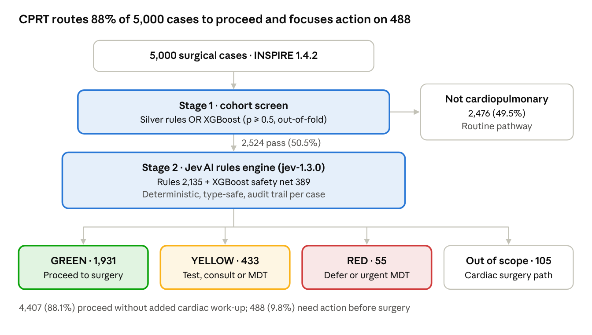

# CPRT Manuscript: LLM-Free Cardiopulmonary Preoperative Triage

Oct 12, 2026 · @REDDY M DEVARAPALLI

## Title page

**Proposed title:** Cardiopulmonary Preoperative Routing Tool (CPRT): A Two-Stage, Large Language Model–Free Triage System Combining Gradient Boosting and Deterministic 2024 ACC/AHA Guideline Rules

**Alternative titles**

1. Hallucination-Free Preoperative Cardiopulmonary Triage: Development and Validation of a Hybrid XGBoost and Type-Safe Rules Engine on the INSPIRE Dataset
2. Screen Wide, Route Strictly: An Explainable Machine Learning and Guideline-Rule Pipeline for Preoperative Cardiac Risk Triage

**Short title:** LLM-free hybrid preoperative cardiopulmonary triage

**Authors:** Reddy M. Devarapalli, MD; Sahil Patel; Shusrita \[surname\]; \[additional authors\]. Affiliations, ORCID and corresponding-author details to be added.

**Keywords:** preoperative evaluation; perioperative cardiovascular risk; clinical decision support; XGBoost; rule-based system; 2024 ACC/AHA guideline; triage; explainable artificial intelligence

**Word count:** \[to be completed\] · **Tables:** 4 · **Figures:** 1

## Abstract

**Background.** Preoperative clinics must identify patients with cardiopulmonary disease and route them through the 2024 ACC/AHA perioperative cardiovascular guideline. Large language models (LLMs) can assist but are nondeterministic, can generate unsupported statements, and raise data-governance concerns. We developed and validated CPRT, a two-stage triage system that uses no LLM: an XGBoost screen followed by Jev AI, a type-safe, deterministic engine that encodes the guideline flowchart.

**Methods.** We used 5,000 de-identified surgical cases from the INSPIRE 1.4.2 dataset. Stage 1 combined rule-based silver labels (cardiothoracic booking, cardiopulmonary ICD-10 history, chronic cardiopulmonary medication) with an XGBoost classifier trained on pre-operative labs, demographics, ASA class, procedure family, and medication classes; a case passed if either the rules or the model (probability ≥0.5) flagged it. Stage 2 (Jev AI) assigned GREEN (proceed), YELLOW (action before surgery), or RED (defer or urgent multidisciplinary review) with a destination and an audit trail. Rules were developed on 52 adjudicated cases, frozen, then validated on 48 independent cases labeled by three blinded clinicians; the reference standard was the majority vote.

**Results.** The XGBoost screen reached an out-of-fold ROC-AUC of 0.874 and recall of 0.957; the rule component had 100% sensitivity against 100 clinician-labelled cases, and the hybrid screen passed 2,524 of 5,000 cases (50.5%) with no missed gold positives. In validation, Jev AI agreed with the clinician majority in 41 of 48 cases (85.4%; 95% CI 75.0–93.8%; κ 0.78), with a population-weighted accuracy of 87.8%. No patient whom the majority classified RED was routed GREEN. Inter-clinician agreement was moderate (Fleiss κ 0.46), and Jev AI agreed with individual clinicians (κ 0.69 and 0.75) at least as well as the two most concordant clinicians agreed with each other (κ 0.69). The pipeline routed 88.1% of all cases to proceed without additional cardiac work-up and concentrated action on 488 (9.8%).

**Conclusion.** A hybrid of gradient boosting and deterministic guideline rules delivered clinician-level preoperative cardiopulmonary triage with full auditability, no generative output and no per-query inference cost. The design supports on-premises, privacy-preserving deployment and warrants prospective validation.

## Introduction

Cardiovascular complications remain a leading cause of morbidity after noncardiac surgery, and the 2024 ACC/AHA perioperative guideline gives clinicians a stepwise flowchart for preoperative evaluation \[1\]. The flowchart asks whether the patient has cardiovascular risk factors, disease, or symptoms; screens for active conditions such as acute coronary syndrome, unstable arrhythmia, and decompensated heart failure; then estimates risk and applies modifiers such as valvular disease, pulmonary hypertension, prior stents, recent stroke, and implanted devices. Applying it consistently to every scheduled patient is labor-intensive, and preoperative clinics vary in how they apply it.

Artificial intelligence could automate this triage. Recent work has focused on large language models, which can read records and draft recommendations. In a safety-critical pathway, however, LLMs have three drawbacks: the same input can yield different outputs; they can produce fluent statements unsupported by the record (hallucinations); and sending patient data to external services complicates privacy compliance. A triage decision that must be reproducible, auditable, and traceable to a guideline node does not need generative text.

We therefore built the Cardiopulmonary Preoperative Routing Tool (CPRT) from two non-generative components.

**XGBoost (Stage 1, screening).** XGBoost is a gradient-boosted decision-tree method \[2\]. It builds hundreds of small decision trees in sequence, each correcting the errors of the previous ones, and outputs a probability. In plain terms, it learns patterns such as "older patient, high troponin, on a beta-blocker and diuretic" that make cardiopulmonary disease likely, even when the diagnosis is not coded. We used it to catch patients that simple code-based rules would miss.

**Jev AI (Stage 2, routing).** Jev AI is a deterministic rules engine built on a type-safe architecture. Each node of the ACC/AHA flowchart is written as an explicit, versioned rule with its class of recommendation. Every input is validated against a typed schema, so missing or malformed data cannot pass silently; missing data becomes "unknown" and triggers clinician confirmation rather than being treated as normal. The same patient always receives the same track, and every decision lists the rules that fired. In plain terms, Jev AI is the guideline flowchart turned into software that cannot improvise.

The aims of this study were to (1) develop the two-stage pipeline on a public perioperative dataset, (2) validate Jev AI against independent, blinded clinician judgement, and (3) estimate its operational impact on a preoperative clinic's workload.

## Methods

### Study design and data source

This was a retrospective development and validation study of a clinical decision-support pipeline, reported following TRIPOD+AI where applicable \[3\]. Data came from INSPIRE version 1.4.2, a publicly available, de-identified perioperative research dataset \[4\] \[confirm source institution and period\]. We drew a 5,000-case working subset (random seed 42, stratified by ASA class) containing operations, all-time ICD-10-CM diagnoses (3-character codes), cardiopulmonary laboratory values, and cardiopulmonary medications with administration route. All event times were relative to operating-room entry, so only data recorded before surgery were used for Stage 2 decisions. Because the data were de-identified and publicly released, \[institutional review board exemption statement to be added\].

### Reference standards

**Stage 1 (is the patient cardiopulmonary?).** A case was positive if it had a cardiothoracic booking (R1), a cardiopulmonary ICD-10 history (R2: I10–I52, I60–I74, J40–J99, C34 and related codes) or a chronic cardiopulmonary medication (R3). Intraoperative vasoactive drugs, perioperative anticoagulant prophylaxis and aspirin alone were excluded. These rule-based "silver" labels were checked against 100 cases labeled by two clinicians, using the guideline's entry question (risk factor, disease or symptom). After the first round, raters agreed on one clarifying rule: two or more antihypertensive agents without a hypertension code indicated hypertension; a single agent did not.

**Stage 2 (which track?).** Clinicians assigned each case GREEN (proceed), YELLOW (an action before surgery: test, consultation or multidisciplinary review), RED (defer or urgent multidisciplinary review) or OUT\_OF\_SCOPE (cardiac surgery, to which the noncardiac guideline does not apply), plus the single most important destination. Raters saw age, sex, ASA class, emergency status, department, procedure code, pre-operative diagnoses with days before surgery, drugs from the prior 30 days with route, and laboratory values from the prior 7 days. Engine output was hidden.

### Algorithm development

**Stage 1.** Features were demographics, body mass index, ASA class, emergency status, procedure family (first three ICD-10-PCS characters), pre-operative laboratory aggregates (minimum, maximum, last value and count per test) and medication-class indicators, 105 features in total. Department and diagnosis codes were excluded to prevent label leakage. Data were split 60/20/20 at patient level, stratified by ASA class and label. XGBoost used early stopping on the validation split, with the operating threshold set to reach 95% validation recall. To avoid optimistic estimates, every case was also scored by five-fold out-of-fold models. Because rules and model each missed different patients, the final screen was deliberately lenient: a case passed if the rules **or** the model (out-of-fold probability ≥0.5) flagged it.

**Stage 2.** Jev AI translated the 2024 ACC/AHA flowcharts (main algorithm, functional-capacity and biomarker branch, the seven risk modifiers, and the valvular sub-pathways) into a versioned rule registry. The engine evaluates, in order: scope (cardiac surgery out of scope); presence of any cardiovascular finding; active cardiac conditions (acute coronary syndrome, cardiac arrest, unstable arrhythmia, decompensated heart failure, recent stroke); emergency status; Revised Cardiac Risk Index (RCRI) \[5\]; risk modifiers; and the biomarker branch. A parallel pulmonary flag routes chronic lung disease, lung cancer, or lung resection to pulmonary optimization, which the cardiovascular guideline does not cover. Development ran on a 52-case set labeled by two clinicians and adjudicated in consensus meetings. It produced four local rules, each documented separately from guideline rules:

1. **Low-risk procedure exception:** procedures with expected 30-day MACE under 1% (ophthalmologic, skin and breast, thyroid and parathyroid, dental, endoscopic, minor gynecologic, superficial, minor ear) may proceed despite recent myocardial infarction or stroke; not applied to cardiac arrest, unstable arrhythmia or decompensated heart failure.
2. **Stroke timing:** stroke or intracranial hemorrhage within 14 days is RED; 15–90 days before cancer surgery is YELLOW (multidisciplinary timing decision); 15–90 days before elective unrelated surgery is RED.
3. **Troponin:** elevated pre-operative troponin without an acute coronary syndrome code is YELLOW (high priority) for low-risk surgery and RED for elevated-risk surgery.
4. **Decompensated heart failure proxy:** pulmonary edema within 30 days with a heart-failure code is RED.

The engine (version jev-1.3.0) was then frozen. No rule changed after validation labelling began.

### Implementation of XGBoost and Jev AI

Both stages run locally in Python (pandas, scikit-learn, xgboost, pydantic). Jev AI's inputs and outputs are pydantic models: a record that fails validation is reported, never triaged. Each output row contains track, priority, destination(s), recommendations with ACC/AHA class, RCRI and its items, modifiers, data gaps, a needs-confirmation flag and an audit trail of fired rule IDs. No component calls an LLM or an external service. The system is designed for HIPAA-aligned deployment: it can run entirely inside an institution's network, transmits no protected health information, and logs every decision \[cite Typesafe/Jev AI documentation\].

### Performance metrics

Stage 1 was evaluated with ROC-AUC, PR-AUC, recall, precision and specificity against silver labels (test split and out-of-fold) and against the clinician gold set. Stage 2 was validated on 48 cases not used in development, sampled across Jev AI's tracks and enriched for heart-failure or atrial-fibrillation cases, and labelled independently by three blinded clinicians, one of whom had no exposure to development. The reference standard was the majority vote. We report agreement and Cohen's κ with bootstrap 95% confidence intervals (4,000 resamples), Fleiss' κ for the three raters, positive predictive value per track, RED sensitivity, and under- and over-triage. Because sampling was stratified by track, we also report accuracy weighted to the track distribution of the full cohort.

### Efficiency analysis

We measured end-to-end wall-clock time for each stage on a standard laptop \[hardware to be specified\] and report per-case processing time. Marginal cost was assessed as external inference or API charges per case.

### Operational impact

We applied the full pipeline to all 5,000 cases and counted patients in each final category: Stage 1 negative, GREEN, YELLOW, RED and out of scope. Patients needing action before surgery (YELLOW or RED) were taken as the workload a preoperative clinic would need to address.

## Results

### Stage 1: cohort screening

Silver rules labelled 2,135 of 5,000 cases (42.7%) cardiopulmonary. Against 100 clinician-labelled cases, the rules had 100% sensitivity and 100% negative predictive value, 61.4% specificity and 66.2% positive predictive value. Inter-rater agreement on the overlapping 30 cases was κ 0.60 in the first round and 0.93 after the antihypertensive clarification.

XGBoost reached ROC-AUC 0.864, PR-AUC 0.865 and recall 0.958 on the held-out test split; out-of-fold performance on all 5,000 cases was nearly identical (ROC-AUC 0.874, recall 0.957), indicating no overfitting (Table 1). Against the clinician gold set, XGBoost alone was less specific than the rules (24.6% vs 61.4%), because diagnoses were withheld from its features. Its value was complementary: the lenient hybrid added 389 rule-negative patients flagged by the model as possible undercoded disease. In total, 2,524 cases (50.5%) passed to Stage 2, and no gold-positive case was missed (sensitivity 100%).

### Stage 2: development

On the 52-case development set, the two clinicians initially agreed in 50% of cases (κ 0.28). Most disagreements reflected policy rather than data: proceeding with low-risk procedures after recent myocardial infarction or stroke, the timing of time-sensitive cancer surgery, and how to treat isolated troponin elevation. Adjudication converted these into the four documented local rules. Agreement between the original engine (v1.1) and the adjudicated labels was 71% (κ 0.57). Development-set agreement after rule refinement is not reported as accuracy, because the rules were tuned on these cases.

### Stage 2: independent validation

All 48 validation cases had a majority label (22 unanimous). Inter-clinician agreement was moderate (Fleiss κ 0.46; pairwise κ 0.30, 0.40 and 0.69). Jev AI agreed with the majority in 41 of 48 cases (85.4%; 95% CI 75.0–93.8%; κ 0.78, 95% CI 0.61–0.91) and with individual clinicians at κ 0.39, 0.69 and 0.75 (Table 2). Positive predictive value was 89% for GREEN, 80% for YELLOW, 88% for RED and 100% for out of scope (Table 3). Weighted to the cohort's track distribution, accuracy was 87.8%.

For safety, Jev AI identified 7 of 9 majority-RED cases as RED and none as GREEN. Of the seven disagreements, four were one-level under-triage and three were one-level over-triage (Table 4). Two under-triaged cases came from engine scope errors that are correctable: the low-risk exception was applied to an endoscopic bladder-tumour resection, and a cancer-surgery timing rule was applied to an unrelated procedure. Two disagreements arose where Jev AI followed the agreed policy and individual raters did not.

### Operational impact

Applied to all 5,000 cases, CPRT classified 2,476 (49.5%) as not cardiopulmonary, 1,931 (38.6%) GREEN, 433 (8.7%) YELLOW, 55 (1.1%) RED and 105 (2.1%) out of scope (Figure 1). In total, 4,407 patients (88.1%) could proceed without additional cardiac work-up, and the clinic's attention could be focused on 488 (9.8%). Each YELLOW or RED card named its destination: for example, echocardiography (Class 1), BNP or NT-proBNP (Class 2a), cardiology, pulmonary optimization or multidisciplinary review.

### Efficiency

The full Stage 2 run on 2,524 patients completed in \[X seconds\] on a laptop CPU (\[Y ms\] per patient), and Stage 1 training plus scoring in \[Z minutes\]. External inference cost was zero, because no LLM or paid API was called. \[Insert timings measured with the `time` command.\]

### Summary

CPRT screened widely without missing gold-positive patients, then routed them with clinician-level agreement, no severe under-triage and a complete audit trail. It did this without generative AI, external data transfer or per-query cost.

## Discussion

A two-stage pipeline with no generative component matched clinician preoperative triage in 85% of independent cases (κ 0.78), never sent a majority-RED patient to proceed, and agreed with individual clinicians at least as well as they agreed with each other. To our knowledge, this is among the first validated, LLM-free implementations of the 2024 ACC/AHA perioperative algorithm that runs end to end from routinely coded data.

**Why no LLM.** Preoperative triage is a decision tree applied to structured data. A deterministic engine fits this task: identical inputs give identical outputs; every track traces to a named rule and its class of recommendation; and the system cannot generate a statement that is not encoded. That eliminates hallucination by construction, although the engine can still misclassify, as the seven disagreements show. Errors are explicit and fixable: each disagreement in Table 4 maps to a specific rule, whereas an LLM error usually has no single cause to correct. The type-safe input layer adds a second safeguard. Missing data are labelled unknown and flagged for confirmation instead of being silently treated as normal.

**Why a hybrid.** The rules alone were already 100% sensitive against clinician labels when diagnoses were coded, and they outperformed XGBoost on specificity. The model's contribution was different: it flagged 389 patients whose laboratory and medication patterns suggested disease that coding missed. A lenient "rules or model" screen trades extra Stage 2 work, which costs nothing computationally, for fewer missed patients, the right trade-off for a screening step.

**Clinician variability is the ceiling.** Inter-clinician agreement was only moderate (Fleiss κ 0.46), consistent with known variability in perioperative risk assessment. Most disagreement concerned grey-zone policy rather than facts: low-risk procedures after recent events, time-sensitive cancer surgery after stroke, transient ischemic attack versus stroke, and isolated troponin elevation. Making such policies explicit, versioned and auditable may itself be a benefit, because an institution can agree on a policy once and apply it to every patient.

**Operational value, speed and cost.** By sending 88% of patients to proceed and concentrating action on fewer than 10%, CPRT could shorten clinic queues and direct cardiology and echocardiography resources to the patients who need them. Because it runs on commodity hardware without paid inference, the marginal cost per patient is effectively zero and throughput is limited only by data extraction.

**Privacy.** Deterministic, on-premises execution means no protected health information leaves the institution, which simplifies HIPAA compliance compared with cloud-hosted LLM services. HIPAA compliance remains a property of the deployment (access control, logging, data agreements), not of the algorithm alone.

## Limitations

1. **Grey-zone cases and reference standard.** Several cases fell in genuine clinical grey areas where reasonable clinicians disagreed (Fleiss κ 0.46). A majority vote of three clinicians is an imperfect reference standard, and some "errors" may reflect legitimate practice variation.
2. **Missing data elements.** INSPIRE contains no natriuretic peptides, functional capacity (METs or DASI), echocardiographic severity or vital signs. Patients reaching the biomarker branch were routed to "obtain BNP" rather than resolved, valve and pulmonary-hypertension severity could not be graded, and detection of unstable arrhythmia and decompensated heart failure relied on codes and treatment proxies. No non-emergency RED for these two conditions occurred, which may reflect under-detection.
3. **Coding granularity.** Diagnoses were 3-character ICD-10 codes, so, for example, stents, valves and implanted devices shared one code (Z95), and code dates may not equal event dates. Several lab values appeared binned for de-identification, making thresholds approximate.
4. **Development-set circularity.** Local rules were derived from the development set, and five development labels were re-adjudicated after engine output was seen. Development agreement is therefore not reported as accuracy; only the frozen-engine validation is.
5. **Sample size and setting.** The validation set was small (48 cases, 9 majority-RED), stratified rather than consecutive, and drawn from a single dataset and health system, limiting precision and generalizability.
6. **Local policy.** The low-risk exception and stroke-timing rules reflect consensus at our institution and depart from strict guideline deferral; other centres may choose differently.
7. **Retrospective design.** Timing, cost and operational effects were estimated, not measured prospectively, and patient outcomes were not assessed.
8. **Known engine errors.** Validation exposed correctable scope errors (endoscopic resection treated as low risk, cancer-site matching, the I45 conduction code). Fixes belong to a future version that requires new validation.

## Conclusions

CPRT, a hybrid of XGBoost screening and the type-safe, deterministic Jev AI rules engine, performed preoperative cardiopulmonary triage under the 2024 ACC/AHA guideline with clinician-level agreement (85.4%, κ 0.78), no severe under-triage and a full audit trail. It uses no large language model, so it produces no generative output, gives identical results for identical inputs, runs locally at negligible cost and keeps patient data on site. Prospective, multicenter validation with richer data (natriuretic peptides, functional capacity, echocardiography) is the next step.

## Tables and figures

**Table 1. Stage 1 screening performance**

| Method | Evaluated against | n | Sensitivity | Specificity | PPV | ROC-AUC |
| --- | --- | --- | --- | --- | --- | --- |
| XGBoost | Silver labels, test split | 1,000 | 0.958 | 0.342 | 0.520 | 0.864 |
| XGBoost | Silver labels, out-of-fold | 5,000 | 0.957 | 0.341 | 0.520 | 0.874 |
| XGBoost | Clinician gold, out-of-fold | 100 | 0.953 | 0.246 | 0.488 | 0.763 |
| Silver rules | Clinician gold | 100 | 1.000 | 0.614 | 0.662 | — |
| Hybrid (rules or XGBoost p ≥0.5) | Clinician gold | 100 | 1.000 | 0.544 | — | — |

**Table 2. Stage 2 validation agreement (n = 48, independent of development)**

| Comparison | Agreement | κ (95% CI) |
| --- | --- | --- |
| Jev AI vs clinician majority | 41/48 (85.4%; 95% CI 75.0–93.8%) | 0.78 (0.61–0.91) |
| Jev AI vs rater 1 | 62% | 0.39 |
| Jev AI vs rater 2 | 79% | 0.69 |
| Jev AI vs rater 3 | 83% | 0.75 |
| Rater 1 vs rater 2 | 53% | 0.30 |
| Rater 1 vs rater 3 | 62% | 0.40 |
| Rater 2 vs rater 3 | 79% | 0.69 |
| All three raters (Fleiss) | 22/48 unanimous | 0.46 |

**Table 3. Jev AI confusion matrix against clinician majority (n = 48)**

| Jev AI ↓ / Majority → | GREEN | YELLOW | RED | Out of scope | PPV |
| --- | --- | --- | --- | --- | --- |
| GREEN | 16 | 2 | 0 | 0 | 89% |
| YELLOW | 2 | 16 | 2 | 0 | 80% |
| RED | 0 | 1 | 7 | 0 | 88% |
| Out of scope | 0 | 0 | 0 | 2 | 100% |

Population-weighted accuracy 87.8%. RED sensitivity 7/9 (78%). Severe under-triage (GREEN when majority RED): 0.

**Table 4. Validation disagreements and their causes**

| Case | Jev AI | Majority | Direction | Cause |
| --- | --- | --- | --- | --- |
| Endoscopic bladder-tumour resection; stroke 23 d, angina, AF | YELLOW | RED | Under | Low-risk exception applied to endoscopic *resection* (scope error) |
| Laryngeal procedure; stroke 20 d, unrelated gastric cancer | YELLOW | RED | Under | Cancer-timing rule applied although the procedure did not treat the cancer |
| Liver resection; cancer, no cardiovascular finding | GREEN | YELLOW | Under | Engine followed agreed "no cardiovascular finding → proceed" policy; raters deviated |
| Thyroidectomy; I45 conduction disorder 15 d | GREEN | YELLOW | Under | I45 not in the arrhythmia code list |
| Cataract; atrial fibrillation 26 d | YELLOW | GREEN | Over | Stable AF before low-risk surgery (grey zone) |
| Cataract; hypertension, asthma | YELLOW | GREEN | Over | Pulmonary flag applied to a low-risk ophthalmic procedure |
| Spinal fusion; TIA 39 d | RED | YELLOW | Over | All raters treated TIA as less severe than stroke |

### Figure 1. Patient flow through CPRT

Stage 1 passes half the cohort to Jev AI; GREEN plus Stage 1 negatives (4,407) proceed, and only 488 YELLOW or RED patients need action before surgery.

## Declarations

**Use of AI tools.** An AI assistant (Claude, Anthropic) helped write analysis code and draft this manuscript. All clinical labels, adjudication decisions and local policies were made by the authors, who verified all results. \[Adjust to target journal's policy.\]

**Data availability.** INSPIRE is available to credentialed users through PhysioNet \[4\]. Analysis code and the Jev AI rule registry (jev-1.3.0) will be made available at https://github.com/reddy7356/cprt.

**Funding and conflicts of interest:** \[to be added\].

## References

1. Thompson A, Fleischmann KE, Smilowitz NR, et al. 2024 AHA/ACC/ACS/ASNC/HRS/SCA/SCCT/SCMR/SVM guideline for perioperative cardiovascular management for noncardiac surgery. *Circulation*. 2024;150:e351–e442. \[verify volume and pages\]
2. Chen T, Guestrin C. XGBoost: a scalable tree boosting system. In: *Proceedings of the 22nd ACM SIGKDD International Conference on Knowledge Discovery and Data Mining*. 2016:785–794.
3. Collins GS, Moons KGM, Dhiman P, et al. TRIPOD+AI statement: updated guidance for reporting clinical prediction models that use regression or machine learning methods. *BMJ*. 2024;385:e078378.
4. &#91;INSPIRE dataset citation: authors, title, journal and PhysioNet DOI; version 1.4.2\]
5. Lee TH, Marcantonio ER, Mangione CM, et al. Derivation and prospective validation of a simple index for prediction of cardiac risk of major noncardiac surgery. *Circulation*. 1999;100:1043–1049.
6. Fleiss JL. Measuring nominal scale agreement among many raters. *Psychol Bull*. 1971;76:378–382.
7. &#91;Typesafe / Jev AI architecture documentation, including HIPAA statement\]

References 1, 3 and 4 should be checked against the publisher before submission.
